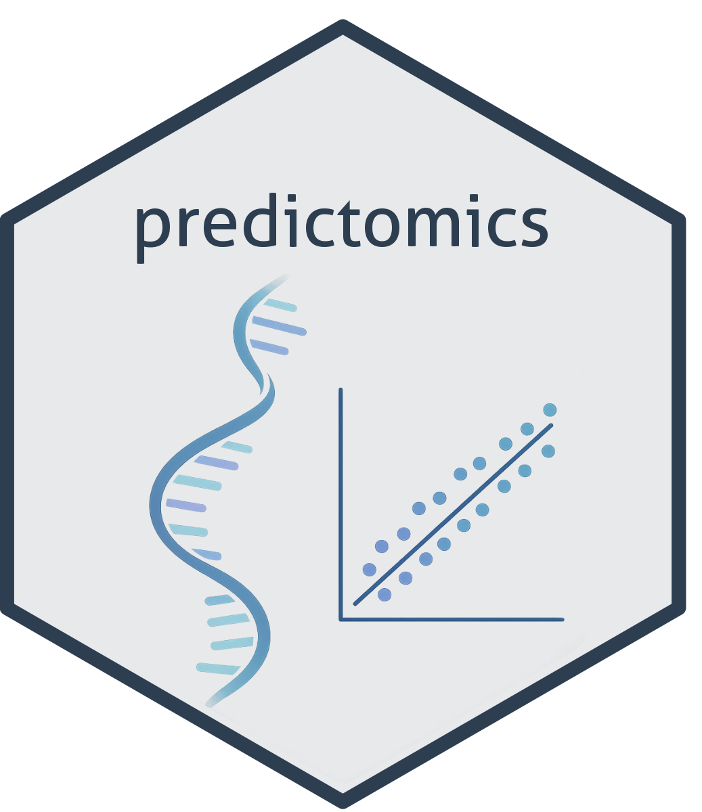

:::: {.software-item}


::: {.software-text}
### SurrogateRank

[This R package](https://cran.r-project.org/web/packages/SurrogateRank/index.html) implements nonparametric rank-based methods for the identification and evaluation of surrogate markers in a small-sample setting. A tutorial [can be found here](https://htmlpreview.github.io/?https://github.com/laylaparast/SurrogateRank/blob/main/SurrogateRank_tutorial.html).
:::
::::

:::: {.software-item}


::: {.software-text}
### predictomics

[This R package](https://github.com/arthurhughes27/predictomics) provides a standardised interface for prediction tasks in the context of omics data. It is not yet available on CRAN.
:::
::::

```{r site-includes, echo=FALSE, results='asis'}
source("includes/site_includes.R"); site_includes()
```
